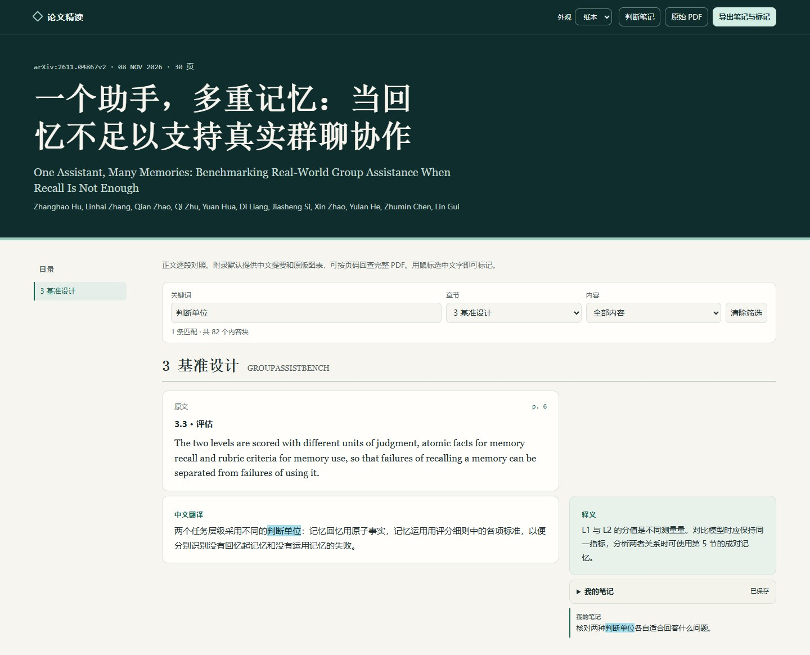

<div align="center">
  <h1>📖 Paper Reader</h1>
  <p><strong>把论文 PDF 变成一份可搜索、可批注的双语精读 HTML</strong></p>
  <p>原文与中文译文对照 · 原版图表 · 离线阅读</p>
</div>



*GroupAssistBench 精读示例。搜索命中同时显示在译文和示例笔记摘录中。*

## 能做什么

| | 功能 | 读起来是什么样 |
| --- | --- | --- |
| 📖 | **双语对照** | 保留原文、页码和高清图表。释义与笔记放在中文译文右侧，窄屏按顺序排列。 |
| 🔎 | **搜索与筛选** | 高亮原文、译文、释义和笔记里的命中词，可按章节、图表、附录或有笔记的段落筛选。 |
| 📝 | **批注与判断** | 选中文字即可高亮、加粗或记下带出处的判断。可补充其他解释与待核实的证据。 |
| 🎨 | **离线阅读** | 支持纸本、清透和夜读三种外观。可导出含笔记与标记的单个 HTML。 |

## 快速开始

下载仓库并保留完整目录。仓库名为 `paper-reader`，Skill 名为 `paper-reading-html`。

| Agent | 使用方式 |
| --- | --- |
| **Codex** | 提供论文 PDF，并让 Codex 按 [SKILL.md](SKILL.md) 生成精读 HTML。 |
| **DeepSeek Harness** | 把完整目录放到项目的 `.dsh/skills/paper-reading-html/`，在会话中指定该 Skill。更多安装位置见[迁移说明](references/portability.md)。 |

> 用 paper-reading-html 处理这篇 PDF。正文逐段对照，附录给提要，附录 F 逐段精读。

生成后双击 HTML 即可阅读。浏览器会本地保存笔记，也可用「导出笔记与标记」保存可携带的副本。

## 命令行

需要 Python 3.10+。文字和布局由 `pdfplumber` 提取，`pypdfium2` 批量渲染图表。布局和裁图可以在同一工作目录中复用。

```sh
python -m pip install "pdfplumber>=0.11.9"
python scripts/prepare_reader.py scan paper.pdf work
python scripts/prepare_reader.py probe work --pages 8,9
python scripts/prepare_reader.py draft paper.pdf work --crops crops.json
python scripts/reader_jobs.py queue work/manuscript.json work/batches
```

根据候选坐标确认 `crops.json`，按批次生成译文补丁，再合并和构建。已有完整稿件时可以直接运行 `build_reader.py`。

```sh
python scripts/reader_jobs.py merge work/manuscript.json work/final.json work/patches
python scripts/build_reader.py work/final.json paper-reader.html --source-pdf paper.pdf
```

[稿件与裁图格式](references/manuscript.md) · [本地机翻与抽查](references/translation.md) · [跨 Agent 迁移](references/portability.md)
